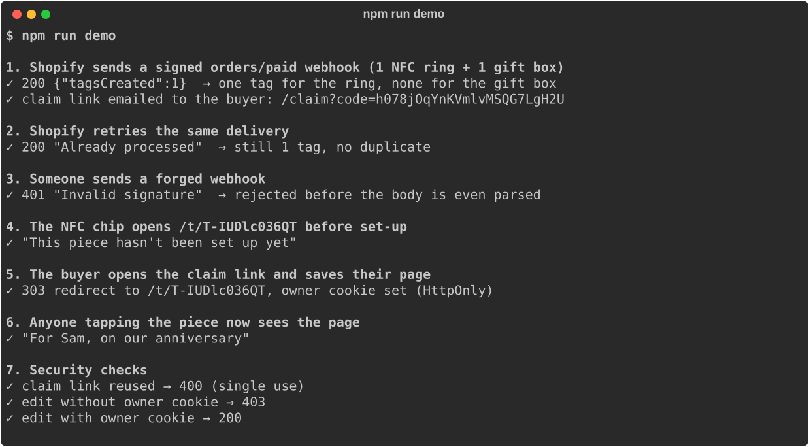
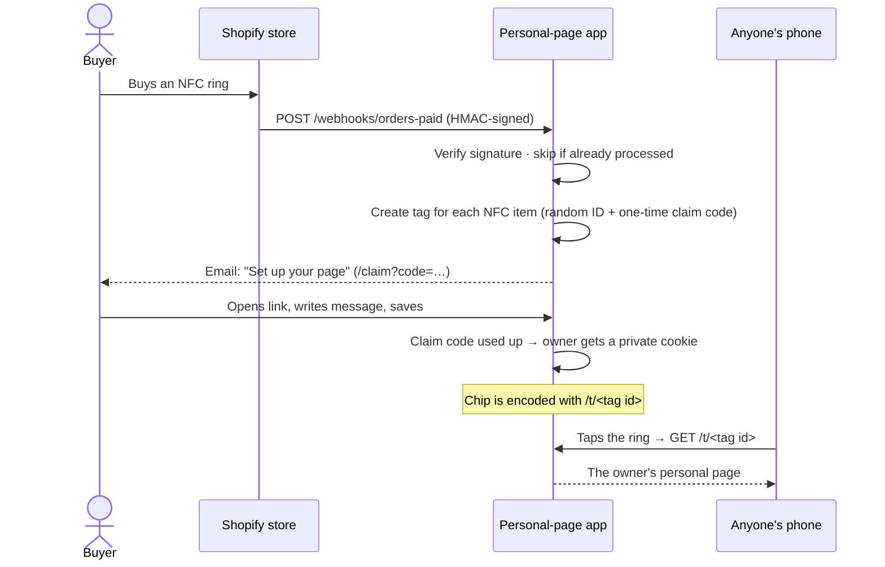

# Everlink: NFC jewellery e-commerce
**Status:** ⏸️ Paused proof of concept · real client project
**Every piece of jewellery has an NFC chip. Tap it with a phone and it opens a personal page set up by its owner.**

Everlink was a client project: a Shopify store for NFC-enabled jewellery, plus a separate web app where buyers claim their piece and build its page. The project is currently paused, and the client's production code is private. This repository shares, with the client's permission:

1. **A working reference implementation of the core flow**, written for this repo: a paid order → a signed Shopify webhook → an NFC tag → a claim link → a personal page.
2. **The Shopify 2.0 storefront theme** built for the brand ([`theme/`](theme/)).
3. **The `CLAUDE.md` spec** the theme was built from ([`docs/theme-CLAUDE.md`](docs/theme-CLAUDE.md)).



---

## How it works



### Why it's built this way

| Decision | Why |
|---|---|
| **Verify the webhook signature on the raw body** | Anyone can send a request to a public URL. Shopify signs every webhook with HMAC-SHA256 of the exact bytes it sent, so we check that before reading anything, using a constant-time compare |
| **Remember processed deliveries** (`X-Shopify-Webhook-Id`) | Shopify retries a webhook if it doesn't get a quick `200`. Without this, one order could create two tags. A delivery is only marked done *after* its tags are created, so a crash mid-way lets the retry finish the job |
| **Random tag IDs in the chip URL** | The URL is public by nature (anyone can tap the piece), so it mustn't be guessable or sequential |
| **One-time claim codes, stored only as hashes** | Whoever holds the email link can claim the page, once. A leaked database wouldn't reveal any working links |
| **Owner cookie scoped to that tag's page, `HttpOnly`** | Editing needs no account or password, and scripts on the page can't read the cookie |
| **Everything the owner types is escaped; links must be http(s)** | The page shows user content to strangers, so it has to be safe from script injection |

## Quick start

You need **Node.js 20.12 or newer**. Check with `node --version`, and get the LTS version from [nodejs.org](https://nodejs.org) if needed.

```bash
git clone https://github.com/nomaan02/everlink-nfc-commerce.git
cd everlink-nfc-commerce
npm install
npm run demo
```

**You should see:** the seven steps in the screenshot above, each with a ✓. The demo runs its own local server and fake Shopify order ([`examples/order-paid.json`](examples/order-paid.json)), so no store or account is needed.

Run the tests with `npm test`. **You should see** `# pass 9` and `# fail 0`.

### Connecting a real Shopify development store

1. **Create a [development store](https://shopify.dev/docs/apps/tools/development-stores)** and give your NFC products a SKU starting with `NFC-`.
2. **Copy the settings file:** `cp .env.example .env`
3. **Start the app:** `npm start`. **You should see** `Listening on http://127.0.0.1:3000`.
4. **Make it reachable from the internet** with a tunnel such as `ngrok http 3000`, and set `PUBLIC_URL` in `.env` to the `https://…` address it prints.
5. **Add the webhook:** in Shopify admin go to **Settings → Notifications → Webhooks → Create webhook**. Choose event **Order payment**, format **JSON**, and URL `<PUBLIC_URL>/webhooks/orders-paid`. Copy the signing secret shown on that page into `SHOPIFY_WEBHOOK_SECRET`, then restart the app.
6. **Test it:** place a test order. **You should see** `[email] to …: set up your page at …/claim?code=…` in the terminal. Open that link, save a page, then visit `/t/<tag id>`.

| Problem | Fix |
|---|---|
| `401 Invalid signature` | The secret in `.env` doesn't match the one Shopify shows, or something (a proxy, a body parser) changed the request body |
| `{"tagsCreated":0}` | None of the order's SKUs start with `NFC_SKU_PREFIX` |
| The claim link says it's not valid | Each link works once. Once claimed, tap the piece (or visit `/t/<tag id>`) instead |

## The storefront theme

[`theme/`](theme/) is a complete **Shopify Online Store 2.0** theme for the brand: hero banner, about, featured products, product categories, testimonials, partner logos, newsletter, contact form, plus cart, search, blog and product templates. It follows one rule from its spec: **every visible element is editable in the Shopify theme editor**, with nothing hard-coded. Every section has a `` with text, image, colour and link settings.

To try it, zip the folder's contents and upload them in **Online Store → Themes → Add theme → Upload zip file**, or use `shopify theme dev --path theme` with the [Shopify CLI](https://shopify.dev/docs/api/shopify-cli).

## The full production app (private)

The client's production system went further than this reference:

- **Shopify Admin and Storefront APIs**, alongside webhooks, connecting the store to the personal-page app end to end.
- **A standalone website with full user authentication** (sign-up and sign-in) for owners' personalised pages, in place of this reference's one-time links and cookies.

## How I used AI to build this

- **The theme was built with Claude Code from a written spec.** [`docs/theme-CLAUDE.md`](docs/theme-CLAUDE.md) is that spec: design direction, file structure, and hard requirements like "every element controlled by schema settings" and "zero syntax errors". The agent built against it, and I reviewed and fixed the result in a real store (for example, resolving Shopify's schema validation errors).
- **The production app followed the same pattern.** A `CLAUDE.md` set out the flow and the rules, and Claude Code implemented it against that spec.
- **This reference implementation** was written with Claude Code for this repository, then verified by the demo and tests above.

## Licence

[MIT](LICENSE) for the code in this repository. "Everlink" and the brand design belong to the client.
